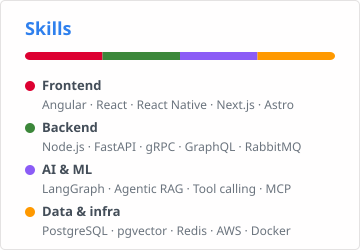

<h1 align="center"> Hi👋, I'm Luca Sargenti </h1>

<h3 align="center"> Senior Product Engineer — Fullstack (Angular, Node.js, AWS) · LLM, RAG & tool calling </h3>

 

- 🔭 I’m currently a Senior Product Engineer at [Docebo](https://www.docebo.com), building the shared Angular design system
- 🌱 I’m currently working through my [AI Engineering Lab](https://luca-sargenti-portfolio.vercel.app/projects/ai-engineering-lab): module 07, agents & orchestration
- 🤖 Lately focused on the LLM layer of products: retrieval, agentic RAG, tool calling and MCP
- 🛠️ 9+ years building software across web, mobile, backend and infra
- 📍 Perugia, Italy · Open to new opportunities

 
 
<h2 align="center">In the section below there are some pinned projects that I worked on!</h2>

### Languages and Tools: ###

&nbsp;
&nbsp;
&nbsp;
&nbsp;
&nbsp;
&nbsp;
&nbsp;
&nbsp;
&nbsp;
&nbsp;
&nbsp;
&nbsp;
&nbsp;
&nbsp;
<picture><source media="(prefers-color-scheme: dark)" srcset="https://api.iconify.design/mdi/github.svg?color=%23ffffff" /></picture>&nbsp;

 

---

### Connect with me: ###
[][website]&nbsp;
[][linkedin]&nbsp;
[][email]

<!-- variables -->
[website]: https://luca-sargenti-portfolio.vercel.app/
[linkedin]: https://www.linkedin.com/in/luca-sargenti-web/
[email]: mailto:luca.sargenti.dev@gmail.com
